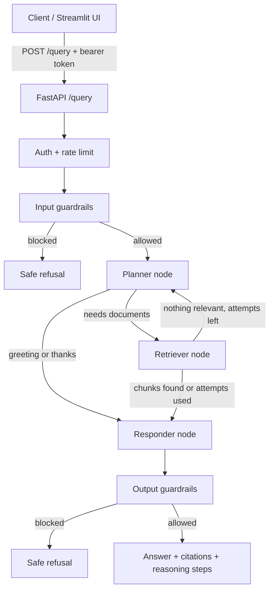

# Architecture

Enterprise Agentic RAG answers questions about technical documentation ("True Data") while
ignoring unrelated content in the same index ("Noisy Data"). Every answer is grounded in
retrieved chunks and cites them; questions outside the supported topics are refused.

## Request flow

1. **Auth and rate limit** (`app/security.py`): optional bearer token, then a per-caller limit
   (Redis when `REDIS_URL` is set, in-memory otherwise).
2. **Input guardrails** (`app/guardrails/`): run before any retrieval, cheapest check first:
   length and empty input → regex for jailbreak, injection and secret patterns → NeMo
   `self check input` rail (one LLM call). The NeMo rail runs **concurrently with the planner**
   (`app/pipeline.py`); if it blocks, the plan is discarded. Planning is read-only (no retrieval, no
   memory writes), so nothing happens for a blocked question beyond one discarded planner call.
3. **Agent** (`app/agents/`, LangGraph):
   - **Planner**: rewrites the question into a standalone one using conversation history,
     decides whether documents are needed, and writes 1–3 search queries. On a re-plan it is
     told which queries already failed.
   - **Retriever**: embeds all planned queries in one Jina call, searches them in one batched
     Qdrant request, merges and dedupes the candidates (best `RERANK_MAX_CANDIDATES` by vector score),
     and reranks them once against the standalone question, keeping the best `AGENT_MAX_CONTEXT_CHUNKS`.
     The number of network round trips is fixed regardless of how many queries the planner wrote. If nothing relevant is found it loops back to the planner,
     up to `AGENT_MAX_ITERATIONS` times.
   - **Responder**: answers only from the retrieved chunks, with `[n]` citations. If nothing
     relevant was found it returns a fixed "not in the documentation" reply **without calling
     the LLM**, so it cannot invent an answer.
4. **Output guardrails**: secret-pattern check, then the NeMo `self check output` rail.

Each request returns `steps`: one entry per stage with a summary and latency, which the UI shows
as "reasoning steps".

## How True Data is separated from Noisy Data

| Layer | Mechanism |
|---|---|
| Ingestion | Every chunk is tagged `dataset: true \| noisy` from its folder (`DATA/true_data`, `DATA/noisy_data`). Used for filtering, metrics and evals, **not** to hide noisy data at query time. |
| Guardrails | Questions outside `GUARDRAILS_ALLOWED_TOPICS` are blocked before retrieval. |
| Vector search | Qdrant returns the top `RETRIEVAL_TOP_K` (20) candidates by cosine similarity. |
| Reranking | The Jina reranker re-scores candidates against the question; anything below `RERANK_MIN_SCORE` is dropped. This is the main noise filter. |
| Responder | Answers only from the remaining context and says so when it isn't enough. |
| Monitoring | `rag_cited_chunks_total{dataset="noisy"}` and the evals' noisy-context rate show leakage. |

Vector similarity alone can't reliably separate them: the synthetic noise files use
technical-sounding vocabulary, and in testing a noise-style question was answered from noisy
files when reranking was unavailable. The reranker threshold is what closes that gap, so tune
it with the evals (see [EVALUATION.md](EVALUATION.md)).

## Components

| Path | Responsibility | Key libraries |
|---|---|---|
| `app/ingestion/loaders/` | Local parsing: PDF (one section per page), HTML (page chrome stripped; headings, code and tables kept), DOCX (paragraphs and tables in order), PPTX (one section per slide: text, tables, native chart data, notes), TXT | pypdf, BeautifulSoup, python-docx, python-pptx |
| `app/ingestion/chunking/` | Paragraph-packing splitter, max 1500 chars. Oversized tables split by row with the header repeated; other text by sentence, then line. Chunks under 50 chars dropped. | — |
| `app/ingestion/pipeline.py` | `DATA/` → `processed_data/<dataset>/<file>.json`. Skips unchanged files by SHA-256. | — |
| `app/services/retrieval/` | Embeddings, Qdrant store, Jina reranker, retriever, indexer | httpx, qdrant-client, sentence-transformers |
| `app/gateway/` | All LLM calls through Portkey, with a fallback chain built from `LLM_MODELS` | portkey-ai |
| `app/guardrails/` | Pattern checks + NeMo self-check rails (NeMo's LLM is routed through the gateway) | nemoguardrails |
| `app/agents/` | LangGraph planner / retriever / responder with per-thread memory | langgraph |
| `app/main.py` | FastAPI: `/query`, `/health`, `/ready`, `/metrics` | fastapi |
| `app/security.py` | Bearer auth, rate limiting | redis |
| `app/metrics.py` | Prometheus counters and histograms | prometheus-client |
| `app/observability.py` | Logfire and LangSmith tracing | logfire, langsmith |
| `ui/app.py` | Streamlit chat client for the API | streamlit |
| `evals/` | RAGAS evaluation runner, CLI and Streamlit demo | ragas |

## Design decisions

**Two named vectors per chunk.** Jina `jina-embeddings-v3` is the primary embedder and
`mxbai-embed-large-v1` runs locally as a fallback. Both are 1024-dimensional, but their vector
spaces are not comparable. Each chunk therefore stores two named vectors in Qdrant (`jina`,
`local`), and a query is searched against the vector of whichever provider embedded it. Mixing
them in one vector would make the fallback return random results.

**Two model tiers.** Short, latency-sensitive calls (guardrail checks, planning) use `LLM_FAST_MODEL`
(`gpt-4o-mini`), called directly through Portkey; if it fails they retry on the main route. Answers
use the main route (`LLM_MODELS` / `PORTKEY_CONFIG_ID`). A saved Portkey config overrides the model
for every request sent with it, which is why the fast tier is sent without one.

**One orchestration path.** `app/pipeline.py` is used by both `/query` and the eval runner, so eval
latency, cost and behaviour reflect production exactly.

**LLM fallback in Portkey, not in code.** `LLM_MODELS` (e.g. `@openai/gpt-4o,@openai/gpt-4o-mini`)
becomes a Portkey fallback config: each model is retried `LLM_RETRY_ATTEMPTS` times, then
Portkey moves to the next on 429/5xx. 400/401 do not fall back, so configuration mistakes stay
visible.

**Structured output by prompt, not provider JSON mode.** The planner asks for JSON in the prompt
and validates it with Pydantic, retrying once with the error. That behaves the same on every
fallback model.

**Guardrails fail closed.** If a NeMo rail cannot run (LLM outage), the request is rejected with
**503** rather than allowed through. The 503 makes clear this is an outage, not a policy block.
Set `GUARDRAILS_FAIL_OPEN=true` to allow instead.

**Conversation memory is per caller.** Threads are stored as `<caller>:<thread_id>`, so one API
key can't read another's conversation by guessing an id. Memory is in-process (LangGraph
`InMemorySaver`), so it is lost on restart and not shared between workers.

**Degrade rather than fail.** Jina embeddings down → local embeddings. Reranker down → vector
order (no threshold applied). Planner LLM fails → search with the original question. Redis down
→ requests allowed and a warning logged.

## Data model

Every chunk (in `processed_data/*.json` and as a Qdrant payload) carries:

| Field | Example |
|---|---|
| `source` | `true_data/cronjobs.docx` |
| `dataset` | `true` / `noisy` |
| `file_type` | `pdf`, `html`, `docx`, `pptx`, `txt` |
| `doc_id` | content hash of the file (first 32 hex chars of SHA-256) |
| `page` / `slide` / `slide_title` | location, when the format has one |
| `title` | document title, when available |
| `chunk_index`, `char_count` | position and size |
| `content_type` | `text` or `table` |

Qdrant has keyword indexes on `dataset`, `source`, `doc_id`, `file_type` and `content_type`, so
any of them can be used in `/query` `filters`.

## Correlation IDs

Every `/query` gets a `trace_id`, returned in the response. The same id appears as the Portkey
trace id on every LLM call, as metadata on every LangSmith run, and as an attribute on the
Logfire `rag_query` span, so one request can be followed across all three.
