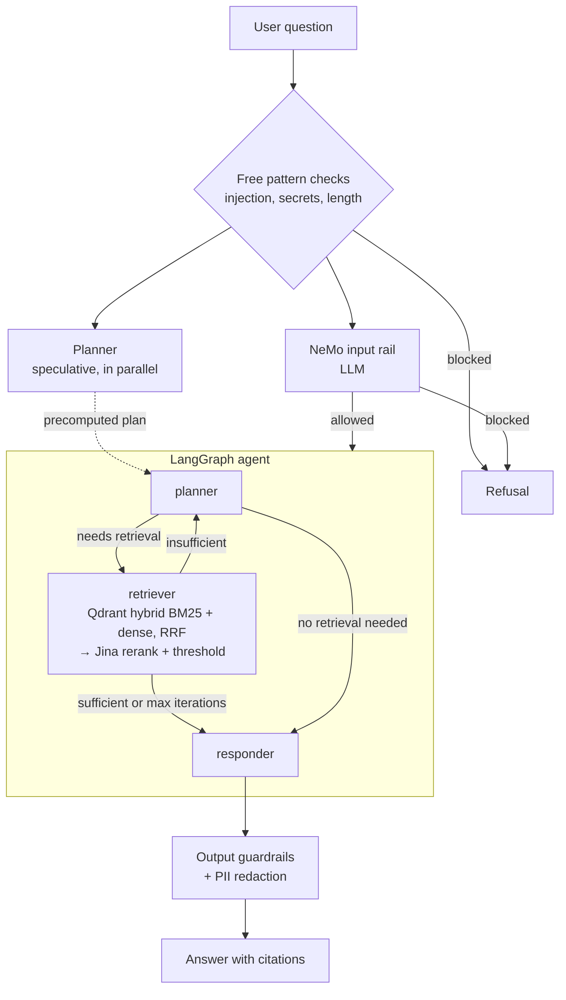

# Enterprise Agentic RAG (Scalable Pipeline)

A production-grade RAG system built with LangGraph, the Portkey LLM gateway (OpenAI), and Jina AI
embeddings and reranker. It separates technical "True Data" from unrelated "Noisy Data" using
semantic reranking, history-aware planning, and NeMo Guardrails for input and output safety.

## Results

The test corpus is **63 documents, split into 5,257 chunks**, of which **97% is unrelated noise**:
6 technical "true" documents (157 chunks) mixed with 57 noisy ones (5,100 chunks), across 5 formats
(PDF, DOCX, PPTX, HTML, TXT). The scores below come from the eval suite (23 cases: 15 RAG questions,
5 guardrail attacks, 3 noise-only probes) on the latest of 6 runs.

| Area | Metric | Score |
|---|---|---|
| Answer quality (RAGAS) | Faithfulness | **0.93** |
| | Answer relevancy | 0.88 |
| | Context precision | **0.91** |
| | Context recall | **0.99** |
| | Factual correctness | 0.67 |
| Retrieval ranking | Recall@5 / Hit@5 / MRR | **1.00 / 1.00 / 1.00** |
| | NDCG@5 | 0.98 |
| Noise isolation | Noisy-chunk citation rate | **0%** |
| | Noise-only probes refused | 3 / 3 |
| Safety | Jailbreak / injection / off-topic blocked | **5 / 5** |
| | Legitimate questions wrongly blocked | 0 |
| Efficiency | Cost per query (mean / p95) | **$0.004** / $0.008 |
| | Latency p50 / p95 | 5.8 s / 12.0 s |

**Improvement over the 6 eval runs** (first run → latest):

| Metric | First | Latest | Change |
|---|---|---|---|
| Context precision | 0.76 | 0.91 | +19% |
| Context recall | 0.90 | 0.99 | +10% |
| Answer relevancy | 0.75 | 0.88 | +17% |
| Factual correctness | 0.58 | 0.67 | +16% |
| Median latency | 10.3 s | 5.8 s | **−43%** |

The eval set is small and hand-written from the source documents, so treat the perfect retrieval
scores as a regression baseline rather than a general benchmark. Factual correctness is the main
area to improve. See [DOCS/EVALUATION.md](DOCS/EVALUATION.md) for how each metric is computed.

## Architecture



All LLM calls (input rail, planner, responder) go through the **Portkey gateway**, with automatic
`gpt-4o` → `gpt-4o-mini` fallback. The input guardrail and the planner **run at the same time**.
If the guardrail blocks the question, the plan is thrown away; it has no side effects. This takes
the guardrail's LLM call off the critical path.

## Features

- **Agentic reasoning:** LangGraph planner → retriever → responder, with re-planning when nothing
  relevant is found and per-conversation memory.
- **Guardrails:** pattern checks plus NeMo Guardrails block off-topic, jailbreak and injection
  inputs before any retrieval, and check answers before they are returned.
- **LLM gateway:** all LLM calls go through Portkey, with model fallback (e.g. `gpt-4o` → `gpt-4o-mini`).
- **Search:** Qdrant Cloud vector search plus the Jina reranker with a relevance threshold.
- **Embeddings:** `jina-embeddings-v3` (1024-dim), with local `mxbai-embed-large-v1` as a fallback.
- **Local parsing:** PDF, HTML, TXT, DOCX and PPTX parsed on-device, with no external OCR service.
- **Observability:** nested traces in Pydantic Logfire and LangSmith across every node; Prometheus
  `/metrics`.
- **Security:** optional bearer-token auth; Redis-backed or in-memory rate limiting.
- **Evaluation:** RAGAS suite (6 metrics), Recall/Precision/NDCG@K, cost per query and True-vs-Noisy
  checks, with a Streamlit demo and a headless `evals/run_evals.py`.
- **Production features** ([DOCS/PRODUCTION.md](DOCS/PRODUCTION.md)): document-level access control,
  persistent memory (SQLite/Postgres), hybrid BM25 + dense search, OCR for scanned PDFs, PII redaction,
  streaming answers, a 👍/👎 feedback loop, auto-ingestion from local/S3/Confluence, and Locust load tests.

## Quick start

```bash
cp .env.example .env     # set PORTKEY_API_KEY, JINA_API_KEY, QDRANT_URL, QDRANT_API_KEY
python3 -m venv .venv && .venv/bin/pip install -r requirements.txt
.venv/bin/python -m app.ingestion.pipeline              # DATA/ -> processed_data/
.venv/bin/python -m app.services.retrieval.indexer      # -> Qdrant
.venv/bin/uvicorn app.main:app --port 8000              # API
.venv/bin/streamlit run ui/app.py                       # chat UI on :8501
```

Or with Docker: `docker compose build && docker compose up -d` (run the two ingestion commands
first; see [DOCS/SETUP.md](DOCS/SETUP.md)).

## Project structure

```
├── app/
│   ├── agents/nodes/       # Planner, Retriever, Responder LangGraph nodes
│   ├── gateway/            # Portkey LLM gateway — primary + fallback model routing
│   ├── guardrails/         # NeMo Guardrails input/output filtering
│   ├── ingestion/
│   │   ├── chunking/       # Section-aware paragraph splitter (1500 char max)
│   │   ├── connectors/     # Auto-ingestion sources — local folder, S3, Confluence
│   │   └── loaders/        # Local parsers — PDF (pypdf + OCR), HTML, TXT, DOCX, PPTX
│   ├── services/retrieval/ # Jina AI embeddings + Qdrant search + Jina AI reranking
│   ├── config.py           # Centralized environment variable management
│   ├── main.py             # FastAPI entrypoint — guardrails gate + /query endpoint
│   ├── security.py         # Bearer auth + rate limiting
│   ├── pipeline.py         # Shared orchestration (guardrails ‖ planning → agent → guardrails)
│   ├── acl.py              # Document-level access control
│   ├── feedback.py         # Answer log + 👍/👎 feedback store
│   ├── metrics.py          # Prometheus metrics
│   └── observability.py    # Logfire + LangSmith tracing
├── loadtest/               # Locust load test
├── evals/                  # RAGAS evaluation suite + Streamlit 3-tab demo
├── ui/                     # Streamlit chat interface with reasoning-step transparency
├── processed_data/         # Auto-generated — parsed & chunked JSON per document
├── DOCS/                   # Architectural and operational guides
├── DATA/                   # Your documents (true_data/ vs noisy_data/) — not included, see DATA/README.md
├── Dockerfile, compose.yaml
└── requirements.txt        # Pinned dependencies
```

## Documentation

See [DOCS/](DOCS/README.md): architecture, setup, configuration, API, operations and evaluation.
